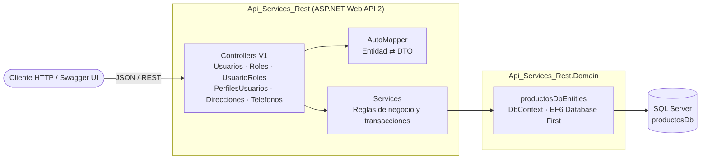
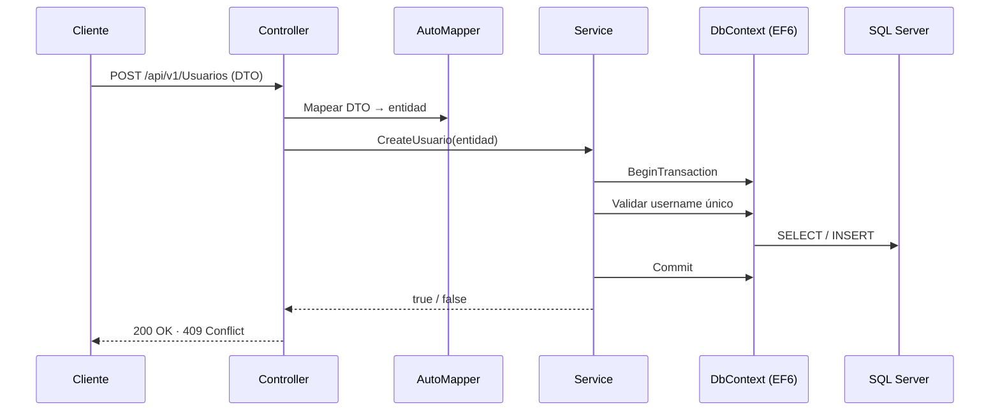
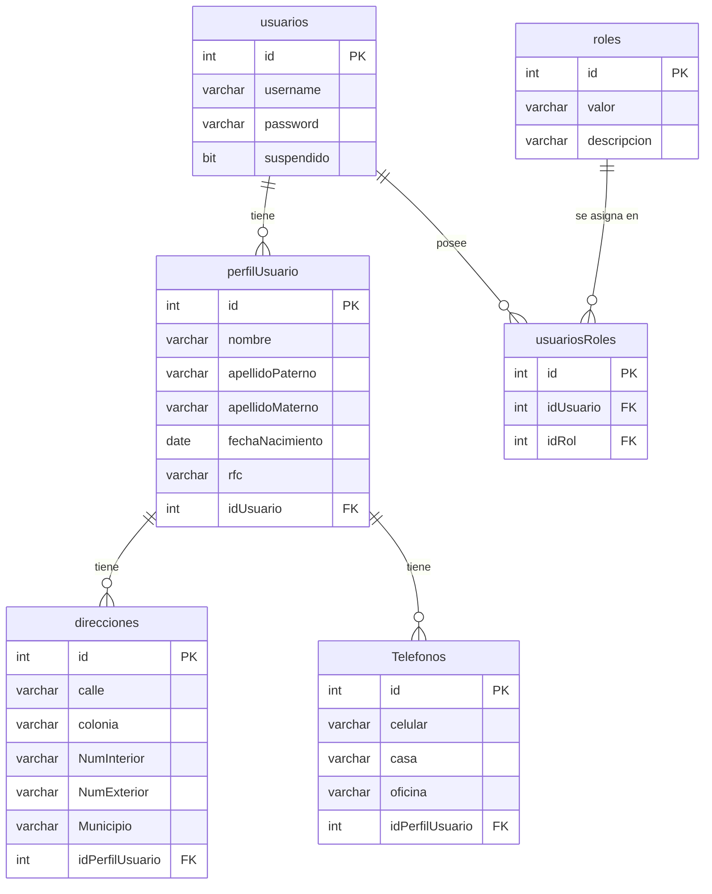

# Gestión de Usuarios · API REST

API REST para la gestión de usuarios, roles, perfiles, direcciones y teléfonos, construida con **ASP.NET Web API 2** sobre **.NET Framework 4.8** y **Entity Framework 6** (Database First) con **SQL Server**.


---

## Tabla de contenido

- [Características](#características)
- [Arquitectura](#arquitectura)
- [Modelo de datos](#modelo-de-datos)
- [Estructura del proyecto](#estructura-del-proyecto)
- [Tecnologías](#tecnologías)
- [Requisitos previos](#requisitos-previos)
- [Instalación y ejecución](#instalación-y-ejecución)
- [Endpoints](#endpoints)
- [Configuración y seguridad](#configuración-y-seguridad)
- [Roadmap](#roadmap)
- [Autor](#autor)

---

## Características

- CRUD de **usuarios**, con consulta por `username` y suspensión/reactivación de cuentas.
- CRUD de **roles** y asignación de roles a usuarios (`UsuarioRoles`).
- CRUD de **perfiles de usuario**, con sus **direcciones** y **teléfonos**.
- Reglas de negocio: `username` único, no se asigna dos veces el mismo rol a un usuario y no se elimina un rol que está asignado.
- Eliminación en cascada controlada desde la capa de servicios (usuario → perfil → direcciones y teléfonos).
- API versionada bajo `/api/v1`.
- Documentación interactiva con **Swagger**.
- Separación entre entidades de base de datos y **DTOs** mediante **AutoMapper**.
- Operaciones de escritura dentro de transacciones.

---

## Arquitectura

La solución está dividida en capas: los controladores reciben las peticiones HTTP, los servicios contienen la lógica y el acceso a datos, y el proyecto de dominio expone el modelo de Entity Framework.



**Flujo de una petición**



---

## Modelo de datos



El script de creación y datos de ejemplo está en [`BaseDatos/ProductosDbV1.sql`](BaseDatos/ProductosDbV1.sql).

---

## Estructura del proyecto

```text
BackGestionUsuarios/
├── BaseDatos/
│   └── ProductosDbV1.sql               # Script de la base de datos
└── Backend/
    ├── Api_Services_Rest/              # Proyecto Web API
    │   ├── App_Start/                  # WebApiConfig, SwaggerConfig
    │   ├── Controllers/V1/             # Controladores REST (api/v1)
    │   ├── Mapper/                     # AutoMapperConfig y MappingProfile
    │   ├── Models/Dto/                 # DTOs expuestos por la API
    │   ├── Services/                   # Lógica de negocio y acceso a datos
    │   ├── Web.config
    │   └── connectionStrings.config.example
    └── Api_Services_Rest.Domain/       # Modelo EF6 (EDMX) y DbContext
```

---

## Tecnologías

| Componente | Versión |
|---|---|
| .NET Framework | 4.8 |
| ASP.NET Web API | 5.3.0 |
| Entity Framework | 6.5.1 |
| AutoMapper | 9.0.0 |
| Swashbuckle (Swagger) | 5.6.0 |
| Newtonsoft.Json | 13.0.4 |
| SQL Server | 2017 o superior |

---

## Requisitos previos

- Windows con **Visual Studio 2022** (carga de trabajo *Desarrollo de ASP.NET y web*).
- **.NET Framework 4.8** Developer Pack.
- **SQL Server** (Express, Developer o superior) y SQL Server Management Studio.

---

## Instalación y ejecución

1. **Clonar el repositorio**

   ```bash
   git clone https://github.com/bleon133/BackGestionUsuarios.git
   cd BackGestionUsuarios
   ```

2. **Crear la base de datos**

   Ejecuta [`BaseDatos/ProductosDbV1.sql`](BaseDatos/ProductosDbV1.sql) en SQL Server. Si la base `productosDb` no existe, créala antes de ejecutar el script.

3. **Configurar la cadena de conexión**

   Copia la plantilla y completa tus datos:

   ```bash
   cp Backend/Api_Services_Rest/connectionStrings.config.example Backend/Api_Services_Rest/connectionStrings.config
   ```

   Edita `connectionStrings.config` y reemplaza `YOUR_SERVER`, `YOUR_USER` y `YOUR_PASSWORD`. Este archivo está en `.gitignore` y no se sube al repositorio.

4. **Abrir y ejecutar**

   Abre `Backend/Api_Services_Rest/Api_Services_Rest.sln` en Visual Studio, restaura los paquetes NuGet y presiona **F5**.

5. **Probar la API**

   Con la aplicación en ejecución, abre `/swagger` en la URL que asigne IIS Express (por ejemplo `https://localhost:{puerto}/swagger`).

---

## Endpoints

Prefijo común: `/api/v1`

### Usuarios · `/api/v1/Usuarios`

| Método | Ruta | Descripción |
|---|---|---|
| GET | `/` | Lista todos los usuarios |
| GET | `/{id}` | Obtiene un usuario por id |
| GET | `/username/{username}` | Obtiene un usuario por username |
| POST | `/` | Crea un usuario |
| PUT | `/{id}` | Actualiza un usuario |
| DELETE | `/{id}` | Elimina un usuario y sus datos relacionados |
| PATCH | `/{id}/toggle-suspendido` | Suspende o reactiva un usuario |

### Roles · `/api/v1/roles`

| Método | Ruta | Descripción |
|---|---|---|
| GET | `/` | Lista todos los roles |
| GET | `/{id}` | Obtiene un rol por id |
| GET | `/nombre/{valor}` | Obtiene un rol por su valor |
| POST | `/` | Crea un rol |
| PUT | `/{id}` | Actualiza un rol |
| DELETE | `/{id}` | Elimina un rol (409 si está asignado) |

### Roles de usuario · `/api/v1/UsuarioRoles`

| Método | Ruta | Descripción |
|---|---|---|
| GET | `/` | Lista todas las asignaciones |
| GET | `/{id}` | Obtiene una asignación por id |
| GET | `/usuario/{idUsuario}` | Lista los roles de un usuario |
| POST | `/` | Asigna un rol a un usuario |
| DELETE | `/{id}` | Quita una asignación |

### Perfiles · `/api/v1/PerfilesUsuarios`

| Método | Ruta | Descripción |
|---|---|---|
| GET | `/` | Lista todos los perfiles |
| GET | `/{id}` | Obtiene un perfil por id |
| GET | `/usuario/{idUsuario}` | Obtiene el perfil de un usuario |
| POST | `/` | Crea un perfil |
| PUT | `/{id}` | Actualiza un perfil |
| DELETE | `/{id}` | Elimina un perfil con sus direcciones y teléfonos |

### Direcciones · `/api/v1/Direcciones`

| Método | Ruta | Descripción |
|---|---|---|
| GET | `/` | Lista todas las direcciones |
| GET | `/{id}` | Obtiene una dirección por id |
| POST | `/` | Crea una dirección |
| PUT | `/{id}` | Actualiza una dirección |
| DELETE | `/{id}` | Elimina una dirección |

### Teléfonos · `/api/v1/Telefonos`

| Método | Ruta | Descripción |
|---|---|---|
| GET | `/` | Lista todos los teléfonos |
| GET | `/{id}` | Obtiene un teléfono por id |
| GET | `/numero/{celular}` | Busca por número de celular |
| GET | `/perfil/{idPerfil}` | Obtiene el teléfono de un perfil |
| POST | `/` | Crea un teléfono |
| PUT | `/{id}` | Actualiza un teléfono |
| DELETE | `/{id}` | Elimina un teléfono |

### Códigos de respuesta

| Código | Significado |
|---|---|
| `200 OK` | Operación exitosa |
| `400 Bad Request` | Id inválido o cuerpo de la petición vacío |
| `404 Not Found` | El recurso no existe |
| `409 Conflict` | Duplicado (`username` o rol ya asignado) o rol en uso |
| `500 Internal Server Error` | Error inesperado del servidor |

---

## Configuración y seguridad

- La cadena de conexión vive en `connectionStrings.config`, que **no** se versiona. Usa siempre `connectionStrings.config.example` como plantilla.
- Para publicar, copia `connectionStrings.Release.config.example` como `connectionStrings.Release.config` y completa los datos del servidor. La configuración **Release** usa ese archivo automáticamente (transform en `Web.Release.config`), mientras que **Debug** sigue usando `connectionStrings.config`.
- Se recomienda un login de SQL Server con permisos mínimos sobre `productosDb` en lugar de `sa`.
- Los datos de ejemplo del script SQL son solo para desarrollo.

> **Nota:** este proyecto aún no incluye autenticación ni autorización. No lo expongas en un entorno público sin completar los puntos del [roadmap](#roadmap).

---

## Roadmap

- [ ] Autenticación y autorización (JWT) con roles.
- [ ] Almacenar contraseñas con hash y no devolverlas en las respuestas.
- [ ] Validación de modelos y DTOs separados para creación y respuesta.
- [ ] Acciones asíncronas e inyección de dependencias.
- [ ] Restringir CORS a orígenes conocidos.
- [ ] Restricciones `UNIQUE` e índices en la base de datos.
- [ ] Pruebas unitarias y de integración.

---

## Autor

Desarrollado por [**bleon133**](https://github.com/bleon133).
